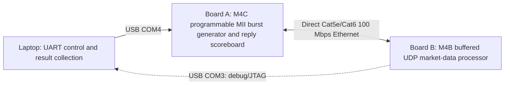

# FPGA Low-Latency Ethernet Processor - dual Artix-7 demonstrator

**v1.0 portfolio edition | Hardware validated 11 November 2026 | SystemVerilog / Vivado 2025.2.1**

A two-FPGA demonstration of a low-latency synthetic market-data processing engine over **100 Mb/s Ethernet (MII)**. Board A generates hardware-paced UDP frames and checks replies; Board B parses packets, updates a single-symbol top-of-book engine and transmits UDP responses via FIFO-buffered clock crossings. Both boards are **Digilent Arty A7-35T**.

> **Scope:** A portfolio and research demonstrator using an original synthetic 16-byte feed record, not a production exchange feed, general-purpose Ethernet stack, trading venue or formally certified CDC implementation.

**Upwork portfolio:** [Low-Latency FPGA Ethernet — view the project on my Upwork profile](https://www.upwork.com/freelancers/~016d7fb025a209e3a2) (Portfolio section).

## Key hardware-verified results

| Metric | Result | Interpretation |
|---|---:|---|
| v0.7 low-latency median RTT | **12.75 us** | Board A counter, sequential 200-packet physical test |
| v0.8B FIFO-buffered median RTT | **12.85 us** | Board A counter, sequential 200-packet physical test |
| v0.6 to v0.7 report-path mean RTT | **1,228.37 -> 12.746 us** | ~99% reduction from eliminating UART-first response gating |
| M4C hardware-paced profile A | **3,000 / 3,000** | 100 us request spacing = 10,000 packet requests/s |
| M4C hardware-paced profile B | **3,000 / 3,000** | 20 us request spacing = 50,000 packet requests/s |
| M4C hardware-paced profile C | **3,000 / 3,000** | 10 us request spacing = 100,000 packet requests/s |
| Final benchmark | **9,000 / 9,000** | Nine 1,000-packet runs; no missing/duplicates/invalid replies |
| Additional smoke test | **1,000 / 1,000** | Independent conservative run |

**Additional hardware startup evidence (14 November 2026):** Profile C's latest manually controlled power-cycle trial passed **5/5 first bursts and 5/5 warm bursts** (10,000/10,000 replies, zero missing). Earlier trials include startup failures and two incomplete runs; the controlled waiting procedure is promising but the exact settling time and root cause were **not measured**. See [Startup/reset reliability and complete trial index](docs/STARTUP_RELIABILITY_2026-11-14.md). These startup results are additional to, not a replacement for, the original nine-run finite-burst benchmark.

**Important:** The 100,000 figure refers to *100 MHz FPGA-measured request-launch spacing* during ~10 ms bursts, not independently observed PHY wire timestamps, indefinite sustainable throughput, maximum packet rate or one-way processing latency. The sequential RTT includes Ethernet PHY transfer and clock crossings.

## System architecture

Board B: 25 MHz PHY RX -> FCS/IP/UDP decoder -> 16-entry async RX FIFO -> 100 MHz parser / single-symbol top-of-book -> 16-entry async response TX FIFO -> MII TX. A separate 8-entry UART diagnostic queue drops diagnostics under overload **without gating the Ethernet response**. Board A: 100 MHz programmable request scheduler -> MII TX -> Board B -> MII reply RX -> unique-sequence scoreboard -> 40-byte UART telemetry.

## Reproduce the design

- **Python:** `python -m pytest -q tests` (52 Python tests were reported passing during M4C development).
- **Icarus:** `powershell.exe -NoProfile -ExecutionPolicy Bypass -File .\\scripts\\run_m4c_sim.ps1` (M4C two-board simulation verified on Windows).
- **Vivado Board A:** `vivado -mode batch -source scripts/build_m4c_generator.tcl`
- **Vivado Board B:** `vivado -mode batch -source scripts/build_m4b_endpoint.tcl`
- **Audit:** `python scripts/audit_m4c_reports.py`, `python scripts/audit_m4b_reports.py` (expects reports generated under `build/`).
- **Hardware:** Direct RJ45 cable **Board A to Board B**, plus separate USB/JTAG/UART. Board A historically COM4, Board B COM3; re-check actual mapping. Program Board A with `ethernet_generator_a7_m4c.bit` and Board B with `ethernet_udp_a7_buffered.bit`, then press/release BTN0 on both and verify link.
- **Smoke:** `python scripts/m4c_hardware_benchmark.py --com COM4 --profile A --repeat 1 --require-all --csv build/hardware/m4c_smoke.csv`
- **Final 3x3:** `python scripts/m4c_hardware_benchmark.py --com COM4 --profile all --repeat 3 --csv build/hardware/m4c_final_3x3.csv`

Full steps in [Reproduction guide](docs/REPRODUCIBILITY_V1.md) and [Benchmark protocol](docs/M4C_BENCHMARK_PROTOCOL.md). The committed evidence is the **reported measurements**; Vivado-generated bitstreams are intentionally excluded and must be built with the correct board/tool setup.

## Final publication documents

- [Architecture and design boundaries](docs/ARCHITECTURE_V1.md)
- [Verification and performance report](docs/VERIFICATION_AND_PERFORMANCE_V1.md)
- [Limitations and release gate](docs/LIMITATIONS_V1.md)
- [Reproduction guide](docs/REPRODUCIBILITY_V1.md)
- [Raw M4C CSV and JSON evidence](evidence/m4c/)
- [Validated machine-readable summary](evidence/REVIEWED_RESULTS.json)
- [GitHub release notes](docs/RELEASE_NOTES_V1.md)
- [Upwork case study](portfolio/UPWORK_CASE_STUDY.md)
- [LinkedIn project summary](portfolio/LINKEDIN_PROJECT.md)

Historical milestone notes remain in the repository for traceability; **this README is the current version**. Earlier status notes describing unfinished builds are historical, not the v1.0 release status.

## Engineering limits

No full-depth order book, no standard exchange protocol, no TCP/IP stack, no PTP/IEEE 1588, no 1 Gb/s Ethernet, no rigorous timing closure across all external/async controls, no formal CDC proof, no saturation boundary or unlimited-rate losslessness claim. FPGA resource and timing figures are Vivado routed implementation reports, not production hardware qualifications. See [limitations](docs/LIMITATIONS_V1.md).

## License

MIT - see [LICENSE](LICENSE). Verify provenance/licensing before public upload; Digilent-derived constraint mappings are indicated in project notes. No proprietary trading data is required.

## Future improvements (separate optional backlog)

See [Future Improvements Register](docs/FUTURE_IMPROVEMENTS.md) for prioritised industrial hardening, throughput instrumentation, protocol expansion, and hardware upgrade ideas. **None of these are required for v1.0 or scheduled work.**
