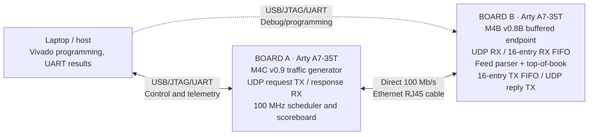

# FPGA Low-Latency Ethernet — Dual Artix-7 Hardware Demonstrator

  

**A reproducible, hardware-tested TWO-FPGA Ethernet/UDP laboratory demonstrator**, implemented in SystemVerilog on **two Digilent Arty A7-35T** boards connected through a direct **100 Mb/s Ethernet MII link**. Board A generates FPGA-paced packet bursts and verifies responses; Board B validates frames, processes synthetic market-data updates and returns Ethernet replies using separate asynchronous buffers.

> **Two boards are needed for the physical system.** You can download the project, **open one Vivado project, inspect both hierarchies and simulate without owning either board**. This version targets **Arty A7-35T**, not the historical Arty S7 UART demonstrations.
>
> **Engineering scope:** fixed synthetic 16-byte feed record and narrow IPv4/UDP envelope, not a production exchange feed, general-purpose TCP/IP stack, certified HFT trading system or formally qualified CDC/PHY implementation.

## Quick start: ONE Vivado project, TWO FPGA designs

On Windows with Vivado 2025.2.1, **double-click [vivado/create_project.cmd](vivado/create_project.cmd)**, or run from a Vivado-enabled command prompt:

    vivado -mode batch -source vivado/create_project.tcl

This generates **one editable .xpr file** to open in Vivado GUI:

    build/v/EthAB/EthAB.xpr

Both designs appear in the source tree. The **only two active physical constraint files** for the final design are `ethernet_m4c_generator.xdc` (A) and `ethernet_m4b_endpoint.xdc` (B). The generator creates compatible copies, `build/v/xdc/A.xdc` and `build/v/xdc/B.xdc`, and assigns one to each mutually exclusive Vivado constraint set. Other XDCs in the repository are **historical references only** and are not loaded into the final `EthAB.xpr`.

Use the Vivado **Tcl Console** from the repository root to select the synthesis hierarchy **and its matching XDC constraints simultaneously**:

    source vivado/board_config.tcl
    fpga_select_board A     ;# M4C traffic generator, board A constraints
    fpga_select_board B     ;# M4B buffered endpoint, board B constraints

| FPGA configuration | Synthesis top | XDC set |
|---|---|---|
| Board A — generator and scoreboard | ethernet_generator_a7_m4c | constrs_board_a |
| Board B — buffered UDP processor | ethernet_udp_a7_buffered | constrs_board_b |

**Do not switch top alone without changing the constraint set.** **Before synthesis/implementation**, execute `report_compile_order -constraints` and confirm that the selected board's XDC appears in **both** sections. A previous local Board B attempt routed with an *empty* `constrs_board_b` despite its name being selected; the PR now includes a fail-closed check for this error. Never generate a bitstream with unconstrained pin locations, clock inputs or `NSTD-1`/`UCIO-1` violations.

The separate simulation top remains `tb_m4c_board_pair`, which instantiates both boards with a simulated MII connection. No physical boards are required to inspect RTL or run behavioral simulation.

The same Vivado project can synthesize, implement and generate **two independent bitstreams**, archived separately by the build driver:

    vivado -mode batch -source vivado/build_targets.tcl -tclargs both

Output locations: build/out/A/board_A.bit and build/out/B/board_B.bit. For interactive GUI building, run fpga_archive_current after each completed bitstream, then fpga_select_board to switch. Synthesis runs are reset on a top change, but archived results remain separate.

**Windows note:** extract the GitHub ZIP to a short folder such as `C:\FPGA\Net` to avoid Windows path-length errors. Keep Vivado working folders short.

**Windows acceptance milestone — 12–13 November 2026:** In the user's existing local `Low-latency-ethernet_v2` GUI working copy, both synthesis tops were independently synthesized, routed, checked, bitstreams generated and saved into separate archives. Board A achieved **+0.576 ns setup WNS**, Board B **+0.737 ns**; both showed zero final DRC violations. These results validate the **local workflow**, but the GitHub branch's subsequently improved XDC self-check and project generator have **not yet undergone a fresh Windows Vivado acceptance run**. CI tests only the Python, Icarus RTL and Tcl-mock packaging paths.

**Read the [one-project GUI guide](docs/VIVADO_GUI_QUICKSTART.md)** and the [13 Nov local Vivado acceptance record](docs/VIVADO_2026-11-13_ACCEPTANCE.md) for the exact results, limitations and next verification gate. No physical RTL or frozen historical XDC was changed by this packaging PR.

## System overview — TWO connected FPGA boards

**Board B critical path:** 25 MHz Ethernet MII/FCS/IPv4/UDP validation → 16-entry asynchronous RX FIFO → 100 MHz feed parser and single-symbol top-of-book → 16-entry asynchronous TX FIFO → MII/UDP Ethernet reply. A separate 8-entry UART diagnostic FIFO may drop debug messages under pressure **without delaying the Ethernet reply**.

**Board A** creates 1,000-packet benchmark bursts in FPGA hardware and checks unique replies; the laptop sends one UART profile command and collects the 40-byte telemetry report. See [architecture](docs/ARCHITECTURE_V1.md).

## Physical hardware results — 11 November 2026 (historical benchmark)

*These measured results predate the 12–13 November `EthAB` GUI packaging builds. The newly archived local bitstreams have not been separately retested as a two-board physical benchmark.*

| Result | Recorded value | Interpretation |
|---|---:|---|
| **v0.7 measured median RTT** | **12.75 µs** | Low-load round trip between two boards |
| **v0.8B buffered median RTT** | **12.85 µs** | Final endpoint, low-load two-board round trip |
| **v0.6 → v0.7 valid-report mean RTT** | **1,228.368 → 12.746 µs** | ~98.96% lower after removing UART-first response gating |
| **Profile A — 10,000 requests/s** | **3,000/3,000** correct replies | Three 1,000-packet finite bursts |
| **Profile B — 50,000 requests/s** | **3,000/3,000** correct replies | Three 1,000-packet finite bursts |
| **Profile C — 100,000 requests/s** | **3,000/3,000** correct replies | Three ~10 ms finite bursts |
| **Total 3 × 3 benchmark** | **9,000/9,000** | No missing, duplicate, invalid replies or late launches |

**Important:** 100,000/s is an **FPGA counter-measured request-launch rate over finite bursts**, not independently observed wire timestamp, maximum wire rate, indefinite sustainable throughput or one-way FPGA processing latency. RTT includes both PHY transfers and CDC. Full evidence: [verification](docs/VERIFICATION_AND_PERFORMANCE_V1.md), [raw final CSV/JSON](evidence/m4c/), [reviewed results](evidence/REVIEWED_RESULTS.json).

## Build, simulate and reproduce

Python reference model / regression:

    python -m pytest -q tests

**Final six RTL benches** (Icarus Verilog: iverilog and vvp required, no FPGA hardware):

    python scripts/run_final_rtl.py

**Existing original Vivado batch flows** (build a *separate* bitstream per board and produce routed reports):

    vivado -mode batch -source scripts/build_m4c_generator.tcl
    vivado -mode batch -source scripts/build_m4b_endpoint.tcl

**Physical benchmark**: Program each FPGA with its matching top's bitstream, use a direct RJ45 cable between Arty A7 boards and independent USB power/JTAG/UART, then reset BTN0 on both. The historical COM4 (A) and COM3 (B) assignments may change on your PC.

    python scripts/m4c_hardware_benchmark.py --com COM4 --profile A --repeat 1 --require-all --csv build/hardware/m4c_smoke.csv
    python scripts/m4c_hardware_benchmark.py --com COM4 --profile all --repeat 3 --csv build/hardware/m4c_final_3x3.csv

**Review actual routed timing/CDC/PHY reports before programming any regenerated bitstream.** A success result from project generation or a positive Vivado slack number is not full hardware signoff. Read [reproduction](docs/REPRODUCIBILITY_V1.md), [benchmark protocol](docs/M4C_BENCHMARK_PROTOCOL.md) and [limitations](docs/LIMITATIONS_V1.md).

## Navigate the repository

| Folder | What you will find |
|---|---|
| [vivado/](vivado/) | Single-project GUI generator, Board A/B selector, dual-build driver and Windows launcher |
| [rtl/](rtl/) | Board A, Board B, shared parsers and FIFOs; historical variants retained |
| [tb/](tb/) | Full simulated two-board link, FIFO and burst testbenches |
| [boards/arty_a7/](boards/arty_a7/) | Final Board A/B XDC plus archived older-stage pin/clock constraints (only 2 active in the generated GUI project) |
| [scripts/](scripts/) | Vivado batch builds, CI RTL regressions, benchmarks, report audits |
| [software/](software/) and [tests/](tests/) | Independent Python/C++ models and regression |
| [evidence/](evidence/) | Primary hardware benchmark CSV/JSON and reviewed summary |
| [docs/](docs/) | Architecture, verified measurements, reproduction, caveats |
| [portfolio/](portfolio/) | Upwork and LinkedIn case studies and publication checklist |

**Active release files:** [13 Nov Vivado acceptance](docs/VIVADO_2026-11-13_ACCEPTANCE.md) · [GUI quick start](docs/VIVADO_GUI_QUICKSTART.md) · [Limitations](docs/LIMITATIONS_V1.md).

**Additional material:** [Release notes](docs/RELEASE_NOTES_V1.md) · [Future improvements (not required for this release)](docs/FUTURE_IMPROVEMENTS.md) · [Upwork case study](portfolio/UPWORK_CASE_STUDY.md) · [LinkedIn summary](portfolio/LINKEDIN_PROJECT.md).

**v1.0 is the source/evidence portfolio packaging, not a new hardware RTL release.** Board A = v0.9 M4C; Board B = v0.8B M4B. Older milestone candidate documents are historical and are not the current release status.

**License:** MIT; verify source authorship and third-party constraint provenance before making this repository public. No proprietary feed data is included.
