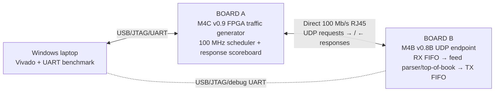

# FPGA Low-Latency Ethernet — two-board Artix-7 demonstrator


[](https://github.com/msamie-elec/FPGA-low-latency-ethernet/actions/workflows/ci.yml)

**A working FPGA-to-FPGA experiment in deterministic Ethernet/UDP traffic generation, buffered packet processing, round-trip response checking, and measurable latency/throughput trade-offs.** The project uses **two Digilent Arty A7-35T boards**, a direct **100 Mb/s RJ45 cable**, SystemVerilog and **one reproducible Vivado project** that builds **two separate FPGA images**.

> **Audience:** FPGA/DSP/network hardware engineers, verification engineers and prospective collaborators. **Scope:** a bounded research/portfolio demonstrator using a synthetic 16-byte market-data-like feed record, *not* a commercial exchange gateway, full TCP/IP stack or formally qualified Ethernet product.

## The idea in 30 seconds

The goal is to learn and demonstrate **how low-latency Ethernet processing can be implemented and measured in FPGA hardware**, not in a Windows packet generator. The central design choice is to keep Ethernet response generation **independent of slow UART diagnostics**, and to use bounded asynchronous FIFOs where the Ethernet PHY clock domains meet the 100 MHz packet-processing core.

**Why TWO FPGAs?** **Board A** is a programmable traffic source and reply scoreboard, while **Board B** is the packet-processing device under test. Board A launches actual Ethernet frames at three controlled rates and validates returned sequence numbers; the laptop merely sends one UART command per burst and collects one 40-byte telemetry record. The two physical PHYs and Ethernet cable exercise a genuine external link.



**Board B processing path:** 25 MHz MII receive and packet/FCS validation → 16-entry asynchronous RX FIFO → 100 MHz synthetic feed parser and **single-symbol** top-of-book → 16-entry asynchronous TX FIFO → MII UDP reply. An independent 8-entry UART diagnostic queue may drop debug messages without stalling replies. **Board A path:** UART `A/B/C` → hardware request scheduler → MII TX → MII reply RX → unique-response scoreboard → 40-byte UART report.

## What has been measured

These are **separate experiments**, not a single composite test:

| Evidence | Observed result | What it establishes |
|---|---|---|
| Historical low-load two-board RTT, buffered B v0.8B | **12.85 µs median** (200/200 functional validation) | Round-trip latency including two Ethernet transfers and clock crossings |
| Original M4C finite-burst matrix, 11 Nov 2026 | **9,000/9,000** valid unique replies across 9 runs | 3 × 1,000 requests each at **10k / 50k / 100k** FPGA launch requests/s, no missing/dup/invalid/late |
| Fresh local `v5` Profile B, 13 Nov | **10/10** 1,000-request runs, zero missing | Repeated 50k/s finite-burst test |
| Fresh local `v5` Profile C, 13 Nov | Initial 10-run attempt: **2 failed, 8 passed**; subsequent separate run **10/10 passed** | Intermittent issue was observed and **must not be hidden** by later passes |
| **Manual BTN0 reset**, Profile C, 13 Nov | **10/10 first + 10/10 warm** bursts passed; 20,000 unique replies, zero missing | Operator-controlled reset and link-ready first-burst test; **not** a power-cycle test |
| **Manually controlled power-cycle test**, Profile C, 14 Nov | **5/5 first + 5/5 warm** bursts passed; 10,000 unique replies, zero missing | Operator confirms both boards were powered off, powered on and reprogrammed before each of five test cycles; physical power events and startup times were **not instrumented** |
| Routed Vivado design, A / B | Setup WNS **+0.576 / +0.737 ns**, hold WHS **+0.052 / +0.046 ns**; zero routed DRC violations in documented local acceptance | Constrained implementation met reported checks; **not** full PHY/CDC signoff |

**Read the evidence and limitations:** [verification and honest result boundaries](docs/VERIFICATION_AND_PERFORMANCE_V1.md), [13 Nov local Vivado reports](docs/VIVADO_2026-11-13_ACCEPTANCE.md), [known gaps](docs/LIMITATIONS_V1.md). The nominal **100,000/s** is Board A's internal FPGA-measured request-*launch* rate during finite ~10 ms bursts, **not independently timestamped wire speed, maximum sustainable throughput or processing latency under load**. Uploaded `v5` reset and power-cycle CSV/JSON were reviewed and committed **byte-for-byte** under [`evidence/hardware/`](evidence/hardware/README.md), separately from Git-ignored local `build/hardware/` outputs. The earlier failed runs also remain part of the record.

## Follow this route through the project

| I want to… | Start here |
|---|---|
| Understand purpose, the reason for two boards and all HDL modules | **[Architecture and complete code/source tree](docs/ARCHITECTURE_V1.md)** |
| Understand `clk`, BTN0, LEDs, UART, Ethernet PHY inputs/outputs and board-specific XDC | **[XDC and physical port reference](docs/XDC_AND_IO_REFERENCE.md)** |
| Download and build one GUI project, simulate, synthesise, implement and make both bitstreams | **[Reproduction / setup guide](docs/REPRODUCIBILITY_V1.md)**; [Vivado step-by-step GUI notes](docs/VIVADO_GUI_QUICKSTART.md) |
| Program the **correct** boards and run the benchmark with exact operator prompts | **[Hardware and simulation test operations](docs/TEST_OPERATIONS_GUIDE.md)** |
| See signals for request → decode → process → reply → scoreboard | [Five-group simulation waveform walkthrough](docs/WAVEFORM_DEMO.md) |
| Understand hardware test fields, how to interpret `PASS`, and save evidence | [Benchmark measurement protocol](docs/M4C_BENCHMARK_PROTOCOL.md) and [first/warm reset protocol](docs/M4C_COLD_START_RELIABILITY.md) |
| Inspect measured results, failures, warnings and remaining risks | [Verification and performance](docs/VERIFICATION_AND_PERFORMANCE_V1.md) · [Limitations](docs/LIMITATIONS_V1.md) · [Future improvement register](docs/FUTURE_IMPROVEMENTS.md) |

## Quick start — simulate and explore without boards

**Minimum:** Windows + AMD Vivado **2025.2.1**. Optional Python 3, `pytest`, `iverilog`/`vvp` and `pyserial` for testing. **Before the draft PRs are merged**, open the GitHub branch [`feature/m4c-cold-start-reliability`](https://github.com/msamie-elec/FPGA-low-latency-ethernet/tree/feature/m4c-cold-start-reliability), click **Code → Download ZIP**, and extract it to a **short path** such as `C:\FPGA\Net`. The ordinary **`main`** ZIP does **not yet include** this updated one-XPR flow. Avoid a long nested project folder.

1. Double-click **`vivado/create_project.cmd`** in Windows Explorer, or from a **Vivado-enabled command prompt** run `vivado -mode batch -source vivado/create_project.tcl`.
2. Open **`build/v/EthAB/EthAB.xpr`**. There is **one** Vivado XPR and **two** separate synthesizable tops; the simulation top is `tb_m4c_board_pair`.
3. In **Vivado Tcl Console** from the repository root:

   ```tcl
   source vivado/board_config.tcl
   fpga_select_board A
   report_compile_order -constraints
   ```

   This selects both the **correct top** `ethernet_generator_a7_m4c` and its **nonempty XDC** `constrs_board_a`. Select B using `fpga_select_board B` only after archiving a finished A image; B uses `ethernet_udp_a7_buffered` and `constrs_board_b`. **Never switch the top without its matching XDC.**

4. Run **Behavioral Simulation**. In **Vivado Tcl Console**:

   ```tcl
   source sim/waves/setup_demo.tcl
   restart
   run all
   ```

   Look for `PASS tb_m4c_board_pair`, correct sequence matches and the final PASS flag. The saved `.wcfg` is generated *locally* under `sim/waves/`, not duplicated in the Git source ZIP. See [`sim/README.md`](sim/README.md) for the separation between simulation setup, HDL testbenches, automated tests and generated results.

5. To build both bitstreams from an installed Vivado command prompt:

   ```bat
   vivado -mode batch -source vivado/build_targets.tcl -tclargs both
   ```

   Separate outputs: **`build/out/A/board_A.bit`** and **`build/out/B/board_B.bit`**. Review effective XDC, zero DRC, route timing, CDC and PHY I/O warnings; successful `write_bitstream` alone is **not** full signoff.

**Optional source regressions** in **PowerShell** from the project root:

```powershell
python -m pytest -q tests
python scripts/run_final_rtl.py
```

## Programming and physical test — short version

Connect both Arty A7 boards to the PC with separate USB cables and connect **their Ethernet sockets directly to each other**. In Vivado **Hardware Manager**, distinguish the two physical JTAG targets and program **A image onto the traffic-generator board** and **B image onto the endpoint board**; then **press and release BTN0 on both** and verify link. The locally observed UART ports were **COM4 = A** and **COM3 = B**, but check yours using `python -m serial.tools.list_ports -v` in PowerShell rather than assuming fixed COM numbers.

Then in **PowerShell** (not Vivado Tcl):

```powershell
python -m pip install pyserial
python scripts/m4c_hardware_benchmark.py --com COM4 --profile A --repeat 1 --require-all --csv build/hardware/smoke_A.csv
python scripts/m4c_hardware_benchmark.py --com COM4 --profile B --repeat 10 --require-all --csv build/hardware/profile_B_10.csv
python scripts/m4c_hardware_benchmark.py --com COM4 --profile C --repeat 10 --require-all --csv build/hardware/profile_C_10.csv
```

Normal benchmark mode **does not request READY**: Board A generates the packets autonomously. For the separate manually controlled reset trial:

```powershell
python scripts/m4c_cold_start.py --com COM4 --mode reset --profile C --cycles 10 --warm-runs 1
```

**Only when Python explicitly prompts `type READY then Enter`:** press/release BTN0 on both boards, check the link, type `READY` in that **same PowerShell window** and press Enter. The first and warm bursts then run automatically. Follow [the exact lab runbook](docs/TEST_OPERATIONS_GUIDE.md) before a physical test. The separately reported `--mode power-cycle` procedure requires powering off/on and reprogramming **both** boards before each test cycle, then checking PHY link before `READY`.

## File layout and GitHub ZIP hygiene

| Area | Contents |
|---|---|
| `rtl/` | 13 current synthesizable SystemVerilog modules |
| `tb/` | Two-board and FIFO/burst testbenches |
| `boards/arty_a7/` | Two current Board A/B physical source XDCs |
| `vivado/` | Single-XPR generator, board/XDC selector, dual-target build driver |
| `sim/waves/` | **One** waveform-generation script; no redundant committed `.wcfg` |
| `scripts/` | Finite-burst hardware benchmark, manual-reset tool, final seven-bench regression |
| `software/`, [`tests/`](tests/README.md) | Reference models and automated test definitions; *not* hardware measurements |
| [`evidence/`](evidence/hardware/README.md), `docs/` | Curated, reviewed measurements (including reset/power-cycle raw captures), warnings and operator instructions |
| `build/` | **Local only** — generated XPR, bitstreams, Vivado reports, raw hardware tests (Git-ignored) |

The **GitHub Code → Download ZIP** is curated with `.gitattributes export-ignore` so older M2/M3 RTL, obsolete XDCs, draft work and generated files are omitted; `git clone` retains tracked engineering history. The ZIP can regenerate an XPR and test vectors, without shipping local bitstreams or personal COM/JTAG identifiers.

## Limitations and engineering roadmap

The largest remaining industrialisation tasks are (1) **formal/structural CDC + Gray-pointer/bus-skew/reset verification**, (2) complete **PHY MII timing and I/O budgets** across PVT, (3) host-visible endpoint overflow/diagnostic counters, (4) **wire-timestamped sustained-load/latency-distribution measurements**, and (5) automated genuine power-cycle/link-recovery stress. The source code does not currently implement 1 GbE, ARP/DHCP/TCP, a multi-symbol order book or general exchange-feed decoding. A later standards-compliant Ethernet system would be a *separate scoped project*, not an implied capability of this one. See [the prioritised future register](docs/FUTURE_IMPROVEMENTS.md).

**Repository publication:** This is a candidate GitHub portfolio release. Source/third-party XDC provenance and unredacted machine identifiers should be reviewed before changing repository visibility. **License:** [MIT](LICENSE).
