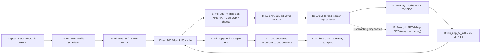

# System architecture and HDL source map — dual Arty A7-35T Ethernet

**Current FPGA RTL:** Board A **M4C v0.9** (`ethernet_generator_a7_m4c`) and Board B **M4B v0.8B** (`ethernet_udp_a7_buffered`). **One Vivado project, two independent bitstreams, two physical FPGA boards.** This is a fixed-format *synthetic* market-data packet-processing demonstrator rather than a production HFT or standards-complete networking product.

## 1. Objective and rationale

The engineering question is: **How can a small FPGA receive Ethernet market-data-like updates, update a stateful processing engine and transmit a response without having slow diagnostics dominate the critical path?** The project builds a bounded, observable experiment in low-latency data movement:

1. Receive a controlled valid UDP/Ethernet feed packet and check its fixed format/FCS.
2. Cross from Ethernet's 25 MHz MII RX domain into the 100 MHz processing clock.
3. Parse a 16-byte synthetic event, maintain a **single-symbol** top-of-book, generate a 14-byte response.
4. Cross back into the Ethernet TX clock domain and reply without waiting for 115200-baud UART debug output.
5. Create traffic and measure packet **request-launch spacing**, replies and errors on a *separate FPGA*, so Windows scheduling/UART speed do not pace every network frame.

The development history is instructive: early v0.6 serial-diagnostic gating caused ~1.23 ms valid-report mean RTT; v0.7 allowed parallel Ethernet reply (~12.746 µs mean for valid reports); v0.8B added independent RX/TX asynchronous buffering while retaining ~12.85 µs median low-load two-board RTT. The current M4C generator adds controlled finite traffic profiles without redesigning Board B.

## 2. Why two boards?

```text
                     USB/JTAG + UART (control, results)
                ┌────────────────────────────────────┐
                │            WINDOWS LAPTOP           │
                └─────────────┬─────────────┬─────────┘
                              │             │
            ┌─────────────────▼─┐     ┌─────▼────────────────┐
            │ BOARD A / Arty A7 │     │ BOARD B / Arty A7   │
            │ Traffic generator │     │ Buffered UDP engine │
            │ + reply scoreboard│     │ + single-symbol book│
            │ 100 MHz scheduler │     │ + separate UART diag│
            └─────────┬─────────┘     └──────────┬───────────┘
                      ╰═══ 100 Mb/s RJ45 MII ═══╯
                           request → / ← reply
```

**A** is a programmable instrument implemented in hardware; it sends precisely defined bursts and checks reply sequence integrity. **B** is the device under test; it validates, processes and responds. The laptop sends *one control byte per burst* and retrieves *one 40-byte result*, instead of trying to time individual Ethernet frames in Python. Two physical board clocks, PHYs and a cable give a more realistic **system-level RTT and reliability exercise** than an internal FPGA loopback; simulation remains idealised and external PHY timing is still not proven.

## 3. End-to-end data paths



MII uses **four data bits per 25 MHz clock**, transmitted low nibble first, as decoded by the **simulation-only** waveform monitors. The RX and TX FIFOs decouple B's independent PHY clocks and core clock. Synchronised Gray-pointer logic controls the queues, but physical Gray bus skew, read-data coherency and reset release are *not* formally signed off. See [CDC and physical caveats](LIMITATIONS_V1.md).

**Packet/application envelope:** the design accepts a fixed IPv4/UDP/broadcast demonstration format and a 16-byte synthetic bid/ask event (side/type, symbol, sequence, price, quantity and reserved content). For accepted updates, the single-symbol book prepares a 14-byte report. It is **not** a general MAC, full ARP/TCP/IP stack or exchange protocol. Frame validity and packet content are separate from the Board A 1000-entry reply-sequence scoreboard; the latter counts unique, duplicated, invalid and unexpected responses in the finite observation window.

## 4. HDL hierarchy — the exact 13 synthesizable files

The generated Vivado XPR intentionally loads only **13 final RTL files**. Older RTL appears in repository Git history/online tree but is excluded from the curated Download ZIP and *not* instantiated by the current XPR.

```text
ethernet_generator_a7_m4c.sv           BOARD A synthesis top
├── uart_rx.sv                        ASCII A/B/C profile input
├── uart_tx.sv                        40-byte benchmark result
├── mii_feed_tx.sv                    Fixed UDP feed-frame generation/MII TX
└── mii_reply_rx.sv                    Ethernet response decoding/MII RX
    (scheduler, sequence scoreboard, counters in Board A top)

ethernet_udp_a7_buffered.sv            BOARD B synthesis top
├── mii_udp_rx_m4b.sv                  MII RX, bounded-frame checks and FCS
├── m4b_async_fifo.sv                  RX clock → system, 16 x 128 bits
├── feed_pipeline.sv                   100 MHz application stream/control
│   ├── feed_parser.sv                  Synthetic 16-byte feed decoding
│   └── top_of_book.sv                  Single-symbol bid/ask state
├── m4b_async_fifo.sv                  System → TX clock, 16 x 116 bits
├── mii_udp_tx_m4b.sv                  UDP reply framing, FCS, MII TX
├── m4b_sync_fifo.sv                   Independent 8-entry UART debug queue
└── uart_tx.sv                         Board B diagnostic serial output

tb_m4c_board_pair.sv                   SIMULATION top only; instantiates both
```

The FIFO is one parameterised source instantiated multiple times; the 13-file count is **unique RTL sources**, not number of hardware instances. Board B has no UART RX command port and is *not* remotely reconfigured by the host benchmark script.

## 5. Clock-domain boundaries

| Domain | Nominal clock | Activities |
|---|---|---|
| A/B system | 100 MHz | Scheduler, command parser, scoreboard, application processing |
| Ethernet RX | 25 MHz, independent PHY RX clock | Request/reply receive and frame validation |
| Ethernet TX | 25 MHz, independent PHY TX clock | Frame emission |
| PHY reference | 25 MHz generated from `clk` / 4 | External PHY reference clock output |

B uses synchronised FIFO control signals to cross domains; A uses toggle-style handshake mailboxes and synchronizers. `set_clock_groups -asynchronous` describes independent domains, but a false/path group declaration **does not itself verify** data stability, metastability protection, bus-skew budgets or reset sequencing.

## 6. Source and delivery tree — curated GitHub ZIP

```text
FPGA-low-latency-ethernet/
├── README.md                      First-view guide, results and navigation
├── .gitattributes                 Curated ZIP: historical/draft files export-ignored
├── .gitignore                     Generated local build and waveform files ignored
├── boards/arty_a7/
│   ├── ethernet_m4c_generator.xdc Board A physical ports and timing assumptions
│   └── ethernet_m4b_endpoint.xdc  Board B physical ports and timing assumptions
├── rtl/                           13 final synthesizable SystemVerilog modules
├── tb/                            Final simulation and FIFO/burst testbenches
├── vivado/
│   ├── create_project.cmd         Windows double-click entry point
│   ├── create_project.tcl         Generate / validate EthAB.xpr
│   ├── board_config.tcl           Select top + effective XDC; archive output
│   ├── build_targets.tcl          Batch A/B build
│   └── check_mii_ports.tcl        Post-synthesis port-count checks
├── sim/waves/setup_demo.tcl       XSim five-group A → B → A waveform layout
├── scripts/
│   ├── run_final_rtl.py           Seven Icarus RTL benches
│   ├── m4c_hardware_benchmark.py  A/B/C finite-burst UART controller/parser
│   ├── m4c_cold_start.py          Manually assisted first-vs-warm tests
│   ├── m2c_vectors.py            Deterministic stimulus generation
│   └── m4b_vectors.py            Deterministic stimulus generation
├── software/                      Reference model(s)
├── tests/                         Host, model and packaging tests
├── evidence/                      Reviewed benchmark results and curated CSV/JSON
└── docs/                          Detailed guides, limitations, test evidence
```

**Generated locally (not source or GitHub Download ZIP):**

```text
build/v/EthAB/EthAB.xpr               The ONE generated GUI project
build/v/xdc/A.xdc, B.xdc              Derived GUI-only XDC copies
build/out/A/board_A.bit                Board A standalone bitstream
build/out/B/board_B.bit                Board B standalone bitstream
build/out/*/*.rpt, build_identity.txt  Routed reports + archive identity
build/hardware/                       Operator benchmark/cold-start evidence
sim/waves/dual_board_demo.wcfg         Generated wave-group layout
```

A normal `git clone` provides the **complete tracked development history** (and the worktree's historical files), while GitHub **Code → Download ZIP** uses `.gitattributes export-ignore` to include the current runnable subset. Future improvements belong in the existing [improvements register](FUTURE_IMPROVEMENTS.md), not as duplicate source trees.

## Read next

[Physical XDC / I/O reference](XDC_AND_IO_REFERENCE.md) · [Step-by-step test operations](TEST_OPERATIONS_GUIDE.md) · [Build/reproduction](REPRODUCIBILITY_V1.md) · [Verification and reported results](VERIFICATION_AND_PERFORMANCE_V1.md) · [Limitations](LIMITATIONS_V1.md).
