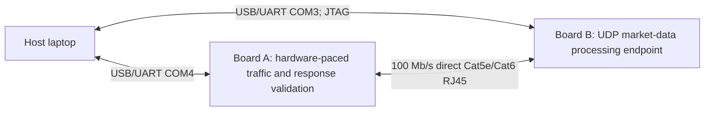
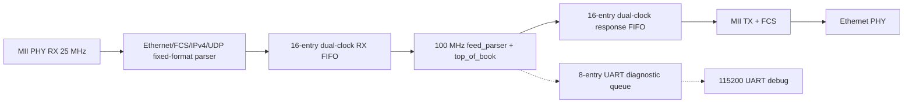

# v1.0 Architecture - Low-latency dual-FPGA Ethernet demonstrator

## Why this architecture

The experiment isolates latency, packet queuing, and diagnostic paths in a realistic small 100 Mb/s FPGA Ethernet workflow. It demonstrates how UART diagnostic serialisation can accidentally dominate application response latency and how independent buffering separates monitoring from the time-critical path. It is not a trading platform.

## Board-level topology

## Data processing path - Board B (v0.8B)

The fixed 16-byte synthetic feed record carries a side, symbol, sequence, price, quantity and reserved field; the core maintains one symbol's latest bid and ask and produces a 14-byte demonstration report for valid input. Ignored and malformed records follow separate response classifications. UDP replies do not wait for UART diagnostics. Under overload, UART diagnostics may be dropped without dropping the corresponding Ethernet reply. Ethernet receive overflow is independently counted in RTL but **not remotely exported in M4C telemetry**.

## Board A (v0.9)

A programmable controller accepts one ASCII profile command `A/B/C` over USB-UART, creates a 1,000-record synthetic workload, and paces requests using its 100 MHz clock. A sequence scoreboard counts unique, duplicate, out-of-range and malformed replies. It returns an exactly 40-byte summary to the host. The controller measures min/max *TX request-launch* gaps, span and late launches; these are not direct wire timestamps.

## Clock domains and constraints

- Processing at 100 MHz; MII RX/TX at 25 MHz.
- Board B uses 16 x 128-bit RX async FIFO and 16 x 116-bit TX async FIFO with synchronised Gray-pointer control; separate 8 x 116-bit diagnostic queue.
- Board A includes request/acknowledgement mailboxes and cross-domain reply capture.
- Vivado routed timing passed in both designs (Board A setup +0.576 ns/hold +0.052 ns; Board B setup +0.737 ns/hold +0.046 ns).
- **These margins are not a formal CDC or external PHY timing proof.** The review identified multi-bit CDC and external I/O methodology warnings; see limitations.

## Distinguishing design stages

v0.6: Ethernet responses effectively waited on UART output, adding large avoidable reply delay. v0.7: Ethernet response began independently of UART, lowering mean hardware RTT for valid reports from ~1,228 to ~12.75 us. v0.8B: RX and TX asynchronous FIFOs plus separate diagnostic buffering, preserving ~12.85 us median sequential RTT. v0.9 M4C Board A: deterministic FPGA-native finite burst measurement; Board B remains unchanged.
