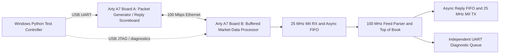

# FPGA Low-Latency Ethernet Market-Data Processor (Dual Artix-7)

**SystemVerilog · Artix-7 35T · 100 Mbps MII Ethernet · Clock-Domain Crossing · Asynchronous FIFO · Hardware Validation**

A synthesizable FPGA networking demonstrator implemented and physically tested on two Digilent Arty A7-35T boards. Board A generates controlled synthetic market-data records; Board B receives IPv4/UDP broadcasts, maintains a single-symbol top of book, and returns 14-byte responses over Ethernet. The implementation supports parallel UART diagnostics, separate 25 MHz PHY and 100 MHz processing domains, and a FIFO-buffered receive/transmit path.

## Results already reproduced on physical FPGA hardware

- v0.5A bidirectional Ethernet: 200/200 correct UDP+UART transactions.
- v0.6 dual FPGA: 200/200 correct transactions; valid-report mean hardware RTT ~1,228.37 µs (the original UART-first architecture).
- v0.7: 200/200 correct direct FPGA-to-FPGA transactions; mean hardware RTT ~12.745 µs, a ~99% reduction after removing UART serialization from the Ethernet response critical path.
- v0.8B: 200/200 correct direct FPGA-to-FPGA transactions; mean hardware RTT ~12.845 µs after adding a 16-entry asynchronous RX FIFO and a 16-entry TX FIFO plus an independent UART diagnostic queue.
- Host-generated 1000-packet no-intentional-delay burst: 982 valid replies, 18 missing in one contiguous block in the independently verified CSV/JSON evidence. The host offered rate is **not** a qualified sustained FPGA throughput.

> **M4C final benchmark results:** To be inserted only after the new Board A generator passes RTL/Vivado and its physical 3x3 profile matrix is run. Do not invent results.

## System architecture

## What this project demonstrates

Deterministic RTL design, finite-state machines, 25/100 MHz clock-domain crossings, FPGA FIFO buffering, independent Python/C++ oracle checking, Vivado placement and routing, MII PHY interfacing, automated SystemVerilog testbenches, measured hardware round-trip latency and evidence-based architecture optimisation.

## Running the project

See `README_M4C.md` for the final M4C Board A tests and `docs/M4C_BENCHMARK_PROTOCOL.md` for the finite hardware throughput workload. Board B uses the v0.8B buffered endpoint. The public repository should expose only the final source files and selected anonymised evidence, not all historical workspaces or generated Vivado directories.

## Limitations

This is a **synthetic, fixed-format IPv4/UDP broadcast demonstration**, not a stock exchange feed handler, trading application, generalized Ethernet/IP stack or production network appliance. FPGA hardware RTT includes both PHY frame transfers and CDC, not just processing. Source-synchronous board delay/skew, comprehensive CDC proof, high-rate physical wire instrumentation and long-term reliability remain outside the validated scope. Shared example source and assets must pass license/privacy checks before public upload.
